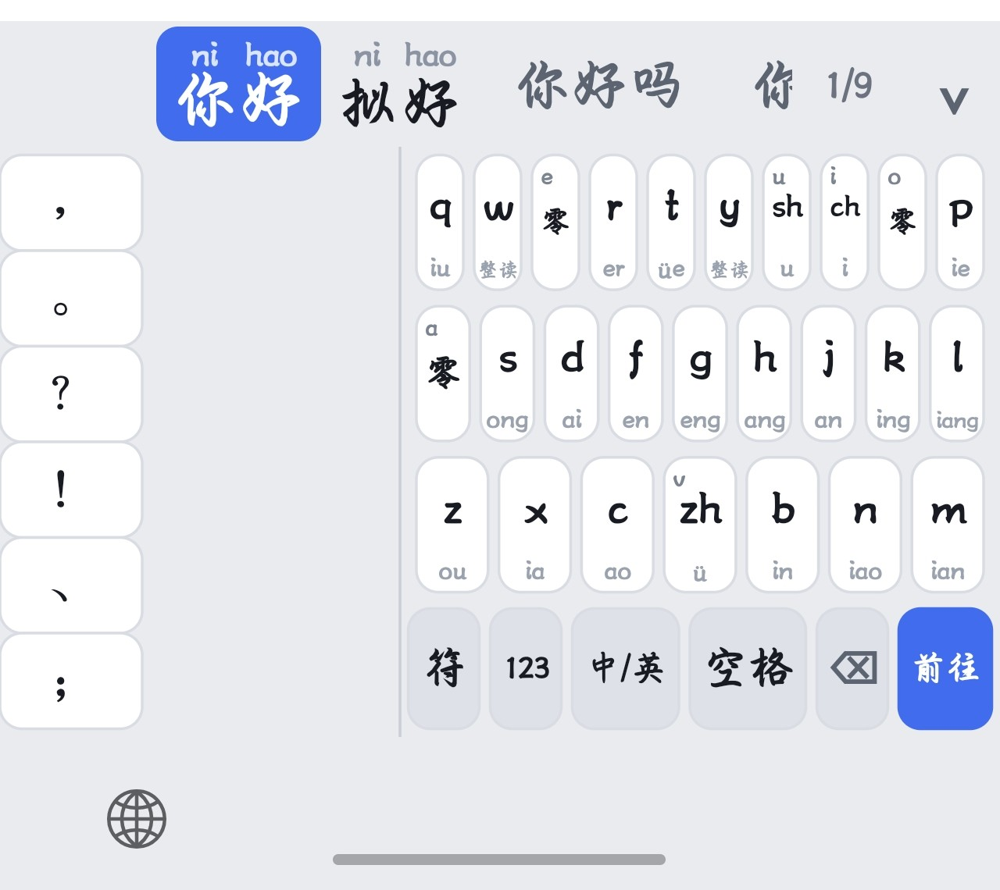

# 双拼输入法

[](https://github.com/Nocool101/ShuangpinKeyboard/actions/workflows/ci.yml)

Android 上的双拼输入法，小鹤、自然码两套方案。

26 键常驻的键盘，按下声母之后只换标签、不换布局。第二阶段那些「一个键两个韵母」的天然歧义（`k`=ing/uai、`s`=ong/iong、`x`=ia/ua……），引擎在按声母那一下就解掉了：接不上的键直接变灰，不用赌。



---

## 键盘

**声母位**（26 键，左上角是键位字母）：

```
 q    w    零   r    t    y    sh   ch   零   p
iu  整体  e  er/uan üe 整体  u    i    o   ie
```

**按 `n` 之后的韵母位**（合法键蓝色高亮，无效键变灰）：

```
 q    w    e    r    t    y    u    i    o    p
iu   ei    e er/uan üe un/ün  u    i    o    ie      ← 灰
 a    s    d    f    g    h    j    k    l
  a ong/iong ai  en  eng ang  an  ing iang/uang
```

`y`、`x` 在这里变灰，因为 `n` 后面根本不接 `un`、`ia`。九个歧义键（`k` `s` `x` `l` `o` `v` `y` `t` `r`）都按这个规则预先消解，按不下的键用户根本按不到。

韵母位固定用小鹤的标准键位：`ao` 永远在 `c`、`ian` 永远在 `m`、`uang` 永远在 `l`。换声母也不动位置——每换一个声母就要重新认一遍键位，肌肉记忆立不住。设置页里留了个「拇指优先」的排法（把韵母聚到拇指一侧），默认关着。

### 三种形态

| 形态 | 说明 |
|---|---|
| 单手·右手（默认） | 整块键盘收窄到屏宽 80%，贴着拇指那一侧，每键约 25 dp；远端空出一条常用标点列 |
| 单手·左手 | 同上，靠左 |
| 全键盘 | 整个屏宽都用上，键是原尺寸 |

80% 是个折中。拇指一次能扫过去的范围是固定的，键摊得太开，最左边几颗够不着；但键太小也按不准（用户实测反馈过两轮：86% 嫌摊太开、60% 嫌键太小）。

「整块都在拇指下」和「键够大」在 QWERTY 布局下是死结：一排 10 个键，键宽 25 dp 就要 270 dp，比拇指能扫过去的范围（约 150 dp）宽得多。要整块都在拇指下，只能减键（10 键 → 6 键）或者把键做小，前者会毁掉双拼的位置记忆，后者用户已经否掉。

### 键盘上的设置

候选区**左边**有一颗 **⚙ 设置键**——单手模式下它贴着屏幕边，正好落在**常用标点竖列的顶端**（跟系统输入法把工具键放在标点列上面是一个道理）。点开是一张浮在键盘上的面板：

| 分区 | 能改什么 |
|---|---|
| 键盘布局 | 全键盘 / 单手·右手 / 单手·左手，韵母位排法（固定小鹤 / 拇指优先） |
| 键盘大小 | 高度 70%~140%、单手宽度 50%~100%，两根滑杆拖着就变 |

改完**立刻生效**，不用重启输入法。面板浮在键盘上面，拖滑杆的时候能看着键盘实时变大变小。

> 键盘高度变了，输入法**窗口**高度也跟着变（窗口 = 候选栏 + 键盘 + 底部留白），不然键盘会被挤出屏幕底下。键盘压到最矮（0.7 倍）时字母键会自动缩小字号，三排字母也不会跟底栏叠在一起。

### 面板

| 面板 | 键位 | 底栏 |
|---|---|---|
| 中文双拼 | 26 键双层标签 | `123` `中/英` `空格` `⌫` `确认` |
| 英文 | 26 键 QWERTY | 同上 |
| 数字 | 顶行符号 + 左列 `% + − * 符号` + 中区 3×4 + 右列 `⌫`/`空格`/`前往` | 无底栏 |
| 标点 | 中英文标点 | `中文` `123` `空格` `⌫` `确认` |

数字面板没有底栏，右列自带退格/空格/确认。数字面板是标点面板唯一的入口（它自己没底栏），所以标点面板左下角给 `中文`：`123` → `符号` → `中文` 两步回到中文面板。

底栏最右那颗**动作键（发送 / 换行 / 前往 / 完成）向左加宽**了：单手 46 dp、全键盘 84 dp。右边贴着屏幕边不动，**往左长**——长出来的那一块是从空格键那儿借的（空格相应窄一点）。**它和退格键之间的空隙一点没少**：空隙是单独算出来的，手指从退格滑过去还是落空，不会误发消息。

数字面板的 `返回` 是「回到文字输入键盘」，不是退格——以前键面写着「返回」却删字，越用越别扭。这个面板自己的退格在右列。

> 面板形态在**宿主重启输入**时保持不变。很多拨号盘收到第一个数字后会调 `restartInput()`（要按号码格式重新整理一遍），这时候键盘**不能**弹回文字面板——否则用户打第一个数字就被打断，还得重新点一次「123」。

---

## 功能

### 打字

**空格是唯一的上屏入口。** 候选、云端给的下一词建议、滑动选中的那一条，全靠空格。右下角那颗蓝键是「动作键」，不选词。

动作键按宿主变身：

| 宿主 | 键面 | 点了之后 |
|---|---|---|
| 微信 / QQ 等聊天工具 | 发送 | 把这条消息发出去 |
| 多行文本框（备忘录、评论框） | 换行 | 换到下一行 |
| 浏览器地址栏 | 前往 | 搜索 / 打开网址 |
| 普通单行输入框 | 完成 | 收尾这一轮输入 |

判定看三样：宿主包名 + 编辑框声明的 action + 是不是多行。只看 action 不够——微信的聊天框既不声明 action 又是多行的，先看多行的话微信就永远发不出消息。规则在引擎层 `ActionKey.resolve()`，20 条单测守着。宿主不认 `performEditorAction` 时退一步发一个回车键事件过去。

**拼音打错了可以点。** 预编辑区里的拼音能点，光标就停在那一处；接着按退格，删的是光标前面那个字（不是最后一个字）；再接着打字，插在光标处，后面已经打好的音节跟在后头。

```
打错 :  xianrifuwoding        ← 「ri」应该是「ren」
点一下: xianri│fuwoding       ← 光标停在 ri 后面
退格 : xianr│fuwoding         ← 删掉那个 i，ri 退回半截音节「r」
补 en: xianren│fuwoding       ← en 在小鹤里是 f 键
结果 : 候选栏第一条 =「仙人抚我顶」，空格上屏也是它
```

半截音节显示的是声母的拼音（`sh` 显示 "sh" 而不是 "u"），不然用户看不出那是什么。引擎层 `InputSession.setCaret()` / `deleteBeforeCaret()`，21 条单测守着。

**长按之后滑动 = 挪拼音里的光标。** 直接滑动是选候选；手指先按住不动（250 ms），这一滑就变成挪光标。不用把手挪到输入框里去点拼音中间。

光标位置看得见：候选栏右边固定显示一小段「`|nihao`，蓝色竖线就是光标在哪。为什么输入法要自己画——不少宿主（实测 Via 的 WebView 搜索框、备忘录）不认 IME 挪预编辑区的光标，功能上挪了、但用户看着光标没动，会以为这一滑没生效。

一步 12 dp（拼音字比正文小，一短些才停得到想改的那个音节上）。空格键也能用——正在打拼音时语音本来就用不上，空格键最大最顺手，按住那儿滑是很自然的动作。

**没在打字时，字母区是一块跟手拖动板。** 手指往哪个方向滑，光标就往哪个方向走，一个字一个字挪（代理对算一个字，emoji 不会被劈开）。往上往下什么都不做——很容易误触。正在输入时横向滑动是选候选。

### 候选栏

**每个字上方标着这个字的拼音**，点角标就能单独改这个字：选完之后那个候选原地替换（「智慧」变「只慧」），位置不变，角标同步更新。改的是用户看到的那个候选的字，不是引擎整句的字——「智慧」和「只会」是同一串拼音的两种切分，不能混。

**滑动选候选。** 在字母区横向滑动就能选，滑完按空格直接上屏选中的那条（没滑过就是第一候选）。滑多远 = 挪几个候选（一步 44 dp）。选中的那条是品牌蓝实底加白字，整排候选里最重的一块，眼睛一扫就知道空格会上的就是它。候选变了、上屏了、退格了，选择自动作废，不会上一条用户已经看不见的候选。

**整串精确命中排第一。** 这一串拼音本身就是词库里的一个词（`xianrenfuwoding` →「仙人抚我顶」），那就是最强的信号，比任何分词结果都强。它排第一，而且不进端侧重排——模型只见过常用词，碰到生僻整词反而会把它排下去（用户明明打对了，第一候选却成了「现任服我定」这种胡拼的句子）。

**选前面的词，后面的拼音不丢。** 打「cangtianzhijian」，候选里有「苍天之间」（整句），也有「苍天」「之间」。点**前面的**「苍天」：上屏「苍天」，后面那半截「zhijian」**留在预编辑区里**，候选栏接着给「之间」——按空格就上屏，不用重新打字。

**看上文选词（本地，零等待）。** 刚上屏「结」，再打「guo」：光看拼音只能给出「过、国、果……」，排序全靠词频，「过」最常用所以排第一。但用户明明刚打了「结」，他要的是「结果」。

输入法拿**词库自己**做这件事：上一块「结」（jie）+ 这一轮「guo」，在词库里查「jieguo」→ 命中「结果」→ 后半截「果」就是这一轮该给的字。一次二分查找（2 μs），**不用等任何模型**——按完键立刻就是对的。

> 端侧重排模型排不了单字候选（它的图不接受零行输入），云端消歧要 500 ms 防抖 + 一次大模型往返（1.4 s 起）。用户看到的现象就是「候选词第一个显示『过』，得停着不动很长时间才会变成『果』」。本地这条捷径把那个等待直接去掉了。

**剪贴板在候选栏最前面。** 复制一段东西，切回来它就摆在候选栏最前面（📋 标记，跟别的候选一眼分得开）：点一下上屏，或者**按空格上屏**。

它是**一次性**的：

- **上屏**（点它、空格上屏、或上屏别的内容）→ 收起；
- **退格** → 收起（宿主里没字可删时也收）；
- **换个输入框 / 切到别的 App 再切回来** → 不会复活；
- 要再出现，等**重新复制**一次（哪怕复制的内容跟上次一模一样）。

不然它一直占着候选栏最前面，空格键一直会把它上屏（用户想打空格的时候老是被它拦一下）。密码输入框里不给，设置页也能整个关掉（关掉之后不读剪贴板）。

**联想（长词扩展）。** 输入「你好」，除了「你好」还给出「你好吗 / 你好啊 / 你好呀 / 你好毒」——词库里以「你好」开头的更长词。拼音撞了不算数，扩展词必须以某个基准词开头（「shi」能命中「诗艾娜」「世阿弥」）。

**下一词：本地先给，云端再补。** 上屏「智慧」，候选栏立刻出现「智慧城市」这类接着能打的词——本地这批是词库给的（1 ms 内出结果），云端那份到了会补在后面（它更聪明，但要走一次大模型）。

**自学习词库。** 你打过的词会记住，下次打同样的拼音它排第一。

```
这次:选字面板里挑出「炼气士」   →  记下 lianqishi → 炼气士
下次:打 lianqishi               →  候选栏第一位就是「炼气士」
```

词库里根本没有的词也能学——游戏专有名词、人名、缩写、网络用语，靠选字面板一个字一个字挑出来，挑一次就记住。记的是「拼音 → 文字」，整句记一条，再按分词拆成一个个词各记一条（`woxiang`→我想、`chifan`→吃饭），所以以后只打 `chifan` 也直接出「吃饭」。只记两个及以上字的词，单字字表里本来就有。

词条存在应用私有目录（`user_dict.tsv`），只在本机，不上传不联网。设置页能看到已学多少条，也能一键清空。落盘是攒批的（停手 1.5 秒写一次），打字不会顿。

**连着打的两块会学成组合。** 先打「天道」，再打「符文」——以后打 `tiandaofuwen`，候选栏第一个就是「天道符文」（词库里没有这个组合，靠用户自己学出来的）。

只在两块**是连着的**时候才学（中间插了空格、标点就不学），而且词库里已经有的组合不学（「我想」词库里有，学它只会改词频）。要学的是词库里没有的——那是用户自己的用法。

### 自动纠错

**本地拼音容错。** 拼音打错了，在近音变体里找一个明显更常用的词。

打错的方式主要三类：

| 错法 | 例子 | 怎么认出来的 |
|---|---|---|
| 声母记混 | 「智慧」打成 `zihui` | 声母近音组：`z↔zh` `c↔ch` `s↔sh` `n↔l` `f↔h` `r↔l` `m↔n` |
| 韵母记混 | `an↔ang` `en↔eng` `in↔ing` `ian↔iang` `uan↔uang` `ong↔iong` | 韵母近音组 |
| 韵母键按错 | 「仙人抚我顶」打成 `xianrifuwoding` | 原串在词库里根本没有 → 把「同声母换任意韵母」全试一遍 |

近音组变体比宽规则变体更可信，所以排序时近音组优先（排序分 = 词频分 − 12 × 档位）。

还有一条**条件置顶**：纠错候选会排到「整串精确命中」前面——但只在精确命中不存在、或者它的词频分低于 50（是个冷门词，更可能是错打出来的）时。常用词照旧在前，不动它。

**长句里的错字也纠得出来。** 上面那条规则只纠**整串**——候选词必须和音节数一样长。于是打一整句时它**根本不触发**（整句不是词库里的一个词），这正是「大篇幅打文档错别字特别多」的原因。

新的做法按**分词结果**找错的那一段：

```
今天 | 西安 | 日服 | 我顶        ← 用户实际打出来的（全是词库里的怪词）
今天 | 仙人抚我顶                ← 纠正后
```

窗口取「连续几个词」（总音节数 ≤ 5），拿这一段的拼音去试近音/错键变体。两条防乱纠的规矩：窗口的拼音**本身就是个词**就不纠；纠出来的词要在打分上**明显更好**（词库里全是「日服」「我顶」这种怪词，换成同样冷门的词不算数）。

这个计算不便宜（要试几十种变体），所以**放在后台线程跑**：停手 250 ms 才启动，结果回来了再把纠正后的整句摆到候选栏最前面。打字一点不顿。

评测集（290 条按错误类型分层，`TyposEvalTest` 每次改动都跑，低于基线即红）：

| | top1 | 空格命中 |
|---|---|---|
| 近声母（`z/zh`、`c/ch`…） | 76.7% | 72.2% |
| 近韵母（`an/ang`…） | 71.4% | 68.6% |
| 韵母按错键 | 62.0% | 62.0% |
| 声母按错键（已知盲区） | 0.0% | 0.0% |

「声母按错键」那一类故意留着 0%——那是当前的已知盲区，规则不覆盖它。

**云端整句纠错。** 你选了同音错字之后（「我系广东人」的「系」），本地词库救不回来，但大模型看得懂整句话。给一个改正版的候选，点了才改。

云端三个功能（下一词预测 / 按上文消歧 / 整句纠错）**默认全关**，开了之后输入内容会发到端点指向的服务，这是隐私决定，不能替用户做。

### 语音输入

按住空格说话，松手停止。需要在设置里配好识别接口并授予录音权限。

---

## 装

Releases 里有打包好的 APK（[v0.0.2](https://github.com/Nocool101/ShuangpinKeyboard/releases)），也可以自己编。

```powershell
adb install -r app-debug.apk
adb shell ime enable com.shuangpin.ime/.ShuangpinImeService
adb shell ime set   com.shuangpin.ime/.ShuangpinImeService
```

手动装的话：**系统设置 → 语言和输入法 → 虚拟键盘 → 启用并切换**到「双拼输入法」。

荣耀、华为这些 ROM 偶尔会把输入法抢回厂商输入法，重新切一次就行。

桌面有图标，点进去是设置页（云端、语音、键盘形态都在那儿）。

---

## 构建

要 JDK 17，`ANDROID_HOME` 指向 Android SDK。

```powershell
cd android
.\gradlew.bat :engine:test          # 引擎单测，秒级，不需要 Android SDK
.\gradlew.bat :app:assembleDebug    # 出 APK
```

引擎模块是纯 JVM 的，不依赖 Android SDK，所以单测在本地和 CI 上都是秒级跑完。GitHub Actions 里跑的就是这条。

词库要自己转（仓库里已经带了转好的 `phrases.txt`）：

```powershell
# 下载 rime-ice 的 full.zip 解压到某处，然后：
pwsh -File tools/import_dict.ps1 -RimeDir "<rime-ice 的 full 目录>"
```

导入时会按繁简表滤掉繁体字，但**《通用规范汉字表》里的字一律保留**——
繁简表里有 36 个字（乾/覆/蒙/著/徵/於/車…）同时也是规范简体字，
它们是「多义简繁同形字」：繁简表里 `乾→干`（干燥义的繁体），
但乾本身也是简体字（乾隆、乾坤），照着繁简表滤掉就整个打不出来了。

键位表和音节表的唯一真源是 `index.html`（交互原型），改完重新抽取：

```powershell
pwsh -File tools/extract_data.ps1
```

引擎代码里不硬编码任何一张表——键位表、音节表、零声母二段表全是抽出来的数据文件。

---

## 代码结构

```
.
├── index.html                 # 交互原型，键位表与音节表的唯一真源
├── tools/
│   ├── extract_data.ps1       # 从 index.html 抽键位表/音节表
│   ├── import_dict.mjs        # rime-ice 词库 → phrases.txt / chars.txt
│   ├── lexeme_server.mjs      # 云端联想服务（key 留在服务端）
│   └── prototype_check.mjs    # 原型自检，30 条断言
└── android/
    ├── engine/                # 纯 JVM：引擎 + 数据
    │   ├── Data.kt            # 数据结构 + 资源加载
    │   ├── Engine.kt          # 引擎、分词、候选装配
    │   ├── Typos.kt           # 本地拼音容错
    │   ├── Context.kt         # 上下文选词（跨界组合）+ 本地下一词
    │   ├── Corrections.kt     # 长句纠错（后台跑）
    │   ├── Learning.kt        # 组合学习（天道 + 符文 → 天道符文）
    │   ├── Reranker.kt        # 端侧重排模型（ONNX）
    │   └── src/test/          # 260+ 条单测
    └── app/                   # 安卓输入法外壳
        ├── ShuangpinImeService.kt
        ├── ShuangpinKeyboardView.kt
        ├── KeyboardSettingsPanel.kt  # 键盘上的「设置」浮层（布局 + 大小）
        └── SettingsActivity.kt
```

引擎单独拆成模块只有一个理由：它不依赖 Android SDK，于是单测能秒级跑完，以后想搬到桌面端也不用动。

---

## 实现上的几个选择

### 歧义预消解

```kotlin
resolveFinals("b") -> {
  "d" -> ai/bai, "c" -> ao/bao, "k" -> ing/bing, "e" -> (无效), ...
}
```

返回的每个键位永远只有一个合法韵母。

### 整句：分词 + 组句

把音节切成词再拼成句子，一个经典 DP：候选来自词库（单音节且词库没有时回退到该音节最高频的字），打分 = 词频分数 + 长词加分 − 分词罚分。参数是 `tools/segment_eval.mjs` 在 23 句真实句子上网格搜出来的。

实测准确率约 87%。纯 unigram 打分有天然局限——分不出上下文差别，这类要靠 n-gram 整句模型。

原来 DP 只给一条最优切分，等长候选几乎总是只有一条（实测中位 1 个），用户没得选，重排模型也没东西可排。现在用 DAG 上的 K-best DP，每个位置保留 K 条路径。因为一个音节对应一个字，每条切分出来的整句长度都等于音节数，天然是等长候选。

| | N-best 前 | N-best 后 |
|---|---|---|
| 金标准在候选池里 | 81.1% | **84.3%** |
| 等长候选数（中位） | 1 | **4** |
| 有 ≥2 个等长候选的用例 | 24.4% | **89.8%** |

第一条备选与原来的最优切分完全一致，既有行为不变。

### 词库存储：blob + 二分查找

78 万个 key 用 `HashMap<String, String>` 装，光 Map 开销就是 200MB+，Android 上会被系统直接杀掉输入法进程。现在是一整块文本 blob + 行首偏移 IntArray + 二分查找，内存只有文本本身的体积（37MB），查询 2μs。

### 端侧重排模型

候选栏里的等长候选（长度 = 音节数）会交给一个端侧小模型重排，它判断上文支持哪一个。模型是 [chinese-ime-lm](https://github.com/metasequoiaime/chinese-ime-lm) 的 `pinyin-ime-keystroke-reranker-8M`（6 层 / 256 宽 / 8.2 MB / ONNX 图）。

它不做拼音解码——喂拼音得不到中文，只在候选之间排序。喂给它的候选必须等长，混着长短不一的会让它偏向短候选（单字只有一项且常用字概率高），实测整句准确率从 77% 砸到 32%。

上文取本会话已上屏的中文文本。不用宿主的光标前文本，那里会把正在输入的拼音串算进去（模型只认中文），WebView 型的输入框还直接返回 null。

实测（评估集 3997 条）：引擎首选 76.3% → 模型重排 **81.0%**。真机单次决策 5.9~18.9 ms，模型加载 367 ms（后台，不挡启动）。

代价：ONNX Runtime 全量版 arm64 的 .so 就 31 MB，APK 从 9.25 MB 变成 69 MB。（上游的做法是自己编译只含 27 个算子的精简 ORT，静态 1.5 MB，那需要一套我们暂时没有的工具链。）

### 云端能力

```
App ──POST /lexeme──► 联想服务(tools/lexeme_server.mjs) ──► MiniMax M2.5-highspeed
     {"text":"智慧"}          key 留在服务端，绝不进 APK
     → {"next":["城市","校园","生活"]}
```

推荐走自建服务，key 留在服务端，手机里不存密钥：

```powershell
node tools\lexeme_server.mjs --port 8787
```

然后在设置页里选「自建服务」，地址填 `http://192.168.x.x:8787`（填你电脑的局域网 IP），模型名和 API Key 留空。

也可以直连厂商（key 存在手机里，没有服务端缓存，每次都真调模型）：

| 栏 | 填 |
|---|---|
| 连接方式 | 直连厂商 |
| 服务地址 | `https://api.minimax.cn/v1` |
| 模型名 | `MiniMax-M2.5-highspeed` |
| API Key | 你的 `sk-cp-…` |

服务端按「请求里有什么」自动选模式：给了候选池是消歧，给了 `input` 是纠错，只给上文是下一词。服务端还有一道保险：模型挑的词不在候选池里就直接丢掉（用户按不出来的词进了候选栏就是 bug）。

自建服务常跑在局域网，而 Android 9 起默认禁明文 HTTP，不放开就会「联想永远没结果」。产品化请走 HTTPS。

推理型模型（M2.5）偶尔要 12 秒以上才回，客户端读超时给到 20 秒；慢的时候下一词会晚点出现，不影响打字。服务端有 60 秒短时缓存，同一个问题短时间内重复问不会再花一次模型调用（实测 1431 ms → 6 ms）。

### 联想（长词扩展）

靠的是词库的一个性质：`phrases.txt` 按拼音串有序，所以「以某个拼音串为前缀的所有词条」可以二分定位 + 向前扫拿到，不用新建索引。

基准词取该拼音串在词库里的精确候选（词表 + 字表，单音节只有字，少了字表一个扩展都出不来）。区间过大时（单音节前缀能上万行）改走「枚举下一个音节」，412 个音节各做一次精确二分，实测 200~520 μs。分数低于 27 的不要——rime-ice 里 27 分是「没有人工词频」的默认档（全库 43.6%），排序永远沉底。

### 候选栏：横滑 + 页码

候选栏是 `[横滑区] + [右侧页码]`，滚动停下来自动吸附到整页。

页码是候选栏内部的固定一块——候选栏高度一变键盘就上下漂，肌肉记忆就废了。为了塞下逐字拼音角标，候选栏 38dp → 46dp，键盘等量减高 224 → 216dp，总窗口高度不变，键位的绝对位置一个像素都没动。

单字候选限流 12 个。单字是最后一个音节的全部候选字，实测中位 27 个、最大 146 个，尾部全是生僻字；全放进来候选栏中位就有 34 个（9 页）。限到 12 个之后中位 16 个，而常用的字本来就在前面。

---

## 已知限制

- **「整块都在拇指下」和「键够大」在 QWERTY 布局下无解**，见上面键盘那节的说明。
- **部分输入框不认输入法挪预编辑区光标**（实测荣耀 Via 浏览器、部分 WebView 型输入框）：功能上光标确实挪了、接着按的键也插在那一处，但输入框里那个可见的光标可能不跟着动。所以输入法会在候选栏右边自己画一段「`|nihao」标出光标位置，以它为准。
- **部分宿主上报的「预编辑区长度」口径不统一**（多数报预编辑区之前那段，AOSP 文档说的是整段）。引擎两种口径都算成候选，再用光标前面的真实文字验一次。
- **微信的「发送」依赖微信自己的「按回车键发送消息」设置**，没开的话宿主不认 `performEditorAction`，会退化成发回车键事件。
- **云端功能默认关闭**，开了之后输入内容会发到端点指向的服务。
- **纠错只认得近音错误**。声母整个按错、且不在任何近音组里的情况认不出来（评测集里那 20 条全是 0%）。
- **APK 69 MB**，因为内置了端侧重排模型（8 MB ONNX）和全量 ONNX Runtime（31 MB）。
- **词库来自 rime-ice**，约 78 万条词、4.3 万候选字。

---

## 测试

240 条单测，全在 JVM 侧，秒级跑完：

```powershell
cd android && .\gradlew.bat :engine:test
```

覆盖编码正确性、零声母、歧义预消解、分词与 N-best、词库存储、候选栏装配、端侧重排、云端协议、语音协议、拼音中间编辑、退格与手势。

有 3 条要连本地联想服务，服务没起就跳过；上游限流（HTTP 429）也跳过——额度用完不是代码问题，真故障（502）仍然照常判失败。

原型那边另有一套：`node tools/prototype_check.mjs`（30 条断言，免浏览器）。

真机验证建议用 Via 浏览器（`mark.via.gp`）：它的搜索框是标准 EditText，`uiautomator dump` 能直接读到预编辑区的内容；记账类 App 是 WebView，读不到。

---

## 性能

JVM 基线（`DictionaryLoadBenchmark` 自动测，本机实测），安卓 ART 同量级：

| 指标 | 数值 |
|---|---|
| 核心数据加载（键位表+音节表，主线程同步） | 冷 5.8 ms / 热 5.2 ms |
| 词库加载（23 MB / 78 万拼音串，后台线程） | 163 ms |
| 词候选查询（二分查找） | 2.2 μs/次 |
| 词库堆占用 | 37.4 MB |
| 纠错的增量开销（5 音节输入） | 0.08 ms |

真机（荣耀 BVL-AN16 / Android 17）：TOTAL PSS 约 123 MB（冷启动加载词库和模型时峰值约 153 MB），Java Heap 约 50 MB、Native 约 15 MB。无崩溃。

加载策略是核心数据主线程同步（键盘立刻可用），词库后台线程加载完整体替换。

---

---

## 许可

**GPL-3.0**，全文见 [LICENSE](LICENSE)。

选 GPL-3.0 不是随意选的：分发的词库数据派生自 [rime-ice](https://github.com/iDvel/rime-ice)（雾凇拼音），而 rime-ice 以 GPL-3.0 发布，派生数据必须以相同许可分发，整个项目因此也只能是 GPL-3.0。

| 组成 | 许可 | 说明 |
|---|---|---|
| 本项目源码 | **GPL-3.0** | 引擎 + 安卓外壳 + 工具链 |
| 词库数据（`phrases.txt` / `chars.txt`） | **GPL-3.0** | 来自 rime-ice，这条决定了整个项目的许可 |
| 端侧重排模型（`lm_step.ort`） | **Apache-2.0** | 来自 chinese-ime-lm，可闭源商用；语料署名见 `android/engine/src/main/resources/ime/reranker/NOTICE` |
| 语音识别链路（移植自 @科技小辛 的「极简语音输入法」） | **MIT** | 只移植了 HTTP 上传识别一条链路，上游源码不随本仓库分发 |
| ONNX Runtime | MIT | 端侧重排模型的推理运行时，构建期依赖，不随源码分发 |

完整的第三方出处、义务与署名要求见 [NOTICE](NOTICE)。

要闭源商用的话，必须先整个替换掉词库，不能沿用 rime-ice 的任何词条。端侧重排模型本身是 Apache-2.0，单独拿去闭源商用没有许可障碍。

API key 绝不入库：`MiniMax key.txt` 只给 `tools/lexeme_server.mjs` 用，已被 `.gitignore` 排除。
